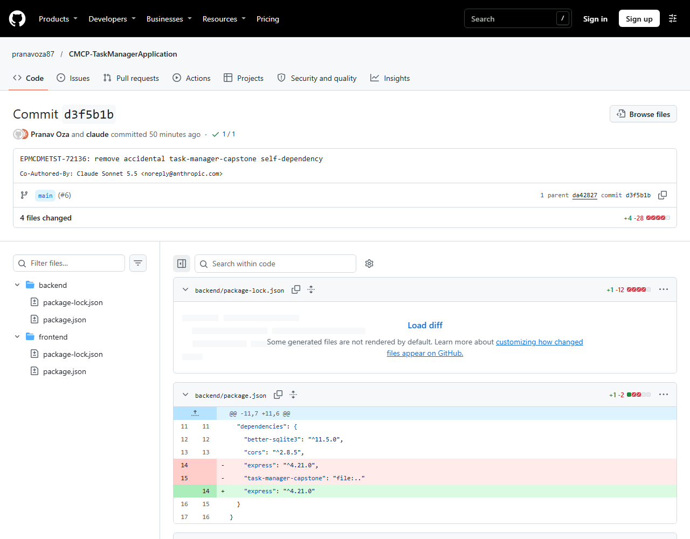
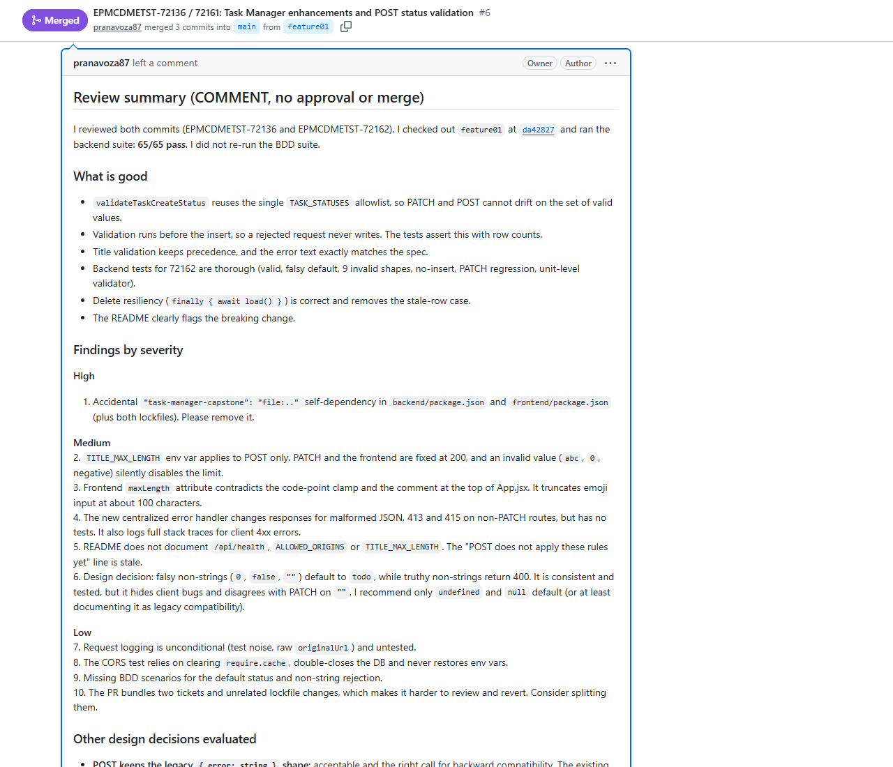
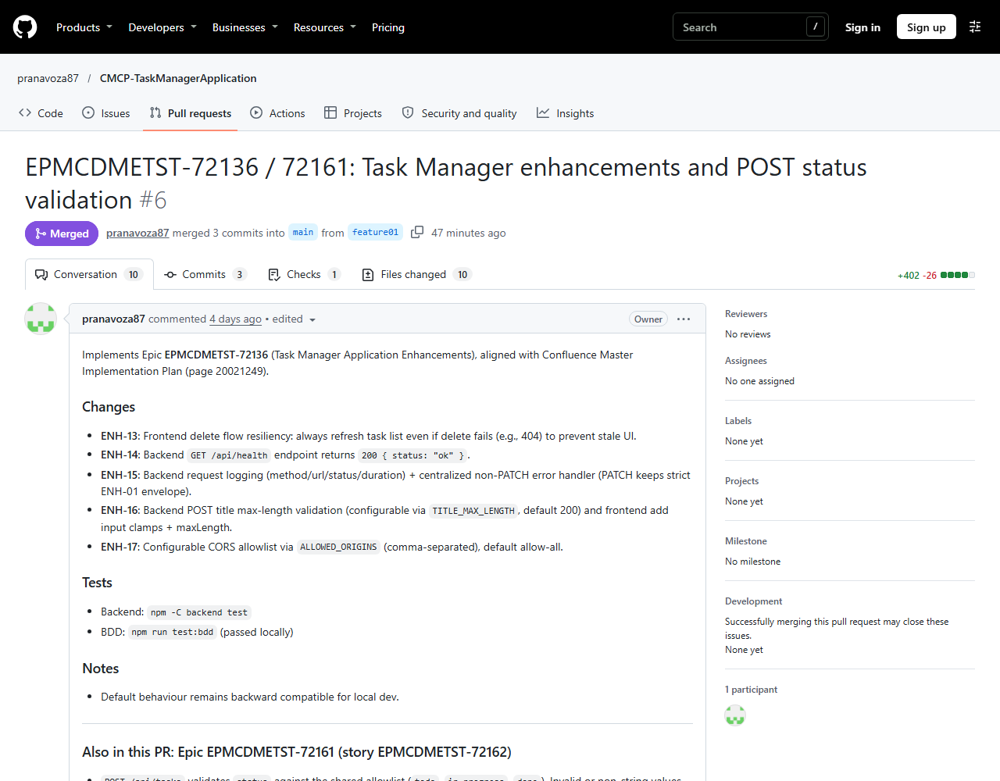
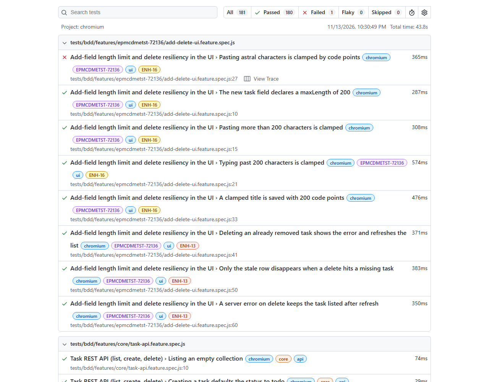
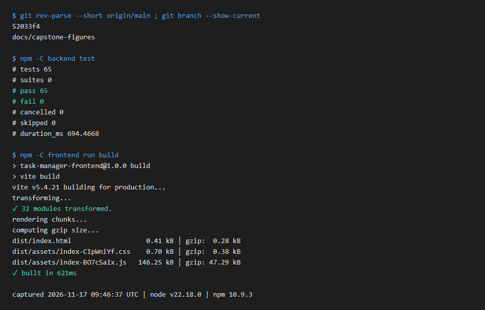
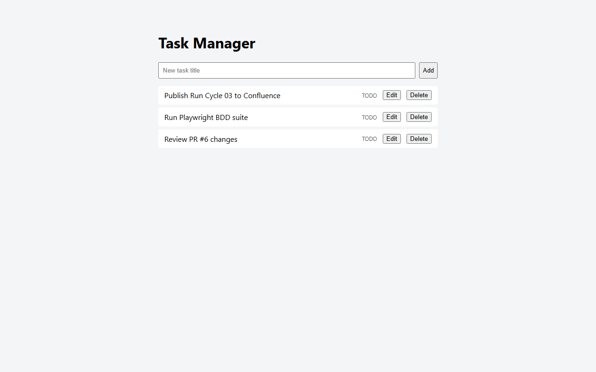

---

# CodeMie Capstone Project Summary
### Automated Requirements-to-Design Workflow for Task Manager Application Enhancements

| | |
|---|---|
| **Jira project key** | EPMCDMETST |
| **Platform** | EPAM CodeMie, multi-assistant workflow |
| **Workflow file** | `TM_Workflow_Final_YAML.yml` |
| **Execution date** | 13 Nov 2026, about 14:37 to 14:47 (about 10 minutes) |
| **Final status** | ✅ **SUCCEEDED** (all 4 assistants and the finalizer) |
| **Author** | Pranav Oza (pranav_oza@epam.com) |

---

## Table of Contents

*(In Word or Google Docs, replace this table with an auto-generated TOC to get page numbers.)*

| Section | Title |
|---|---|
| 1 | Workflow Overview |
| 1.1 | What the workflow does |
| 1.2 | Architecture and flow (Figure 1) |
| 1.3 | Execution status and timeline |
| 1.4 | Summary of generated outputs |
| 2 | Assistant 1: Requirements Generator |
| 3 | Assistant 2: Jira Integration |
| 4 | Assistant 3: Master Plan Generator |
| 5 | Assistant 4: Design Doc Generator |
| 6 | Result Finalizer Node |
| 7 | End-to-End Traceability Matrix |
| 8 | Reviewer Checklist and Evidence Index |
| 9 | Key Design Decisions and Notes |
| 10 | Assistant 5: Code Dev Assistant |
| 11 | Assistant 6: GitHub PR Review & Merge Assistant |
| 12 | Assistant 7: Playwright-BDD Automation Test Generator |
| 13 | Assistant 8: Local Build & Git Deployment Assistant |
| 14 | Assistants 5 to 8: Run Timeline and Hand-off Chain |

---

## 1. Workflow Overview

### 1.1 What the workflow does
This workflow turns one plain-language request into a traceable delivery package. The request was *"Generate new enhancements for task manager application."* Four chained CodeMie assistants run in sequence:

1. **Requirements Generator** analyzes the application and writes structured requirements.
2. **Jira Integration** creates the backlog (Epic → Stories → Sub-tasks).
3. **Master Plan Generator** publishes a Master Implementation Plan to Confluence.
4. **Design Doc Generator** publishes the Architecture, HLD, LLD and Wireframe pages to Confluence.

Each assistant reads the previous assistant's JSON output. It returns JSON that matches its own **JSON Schema (draft-07)**.

### 1.2 Architecture and flow

**Figure 1: Workflow diagram** 

**Figure 1 file:** `images/20261117T073612.329208Z.png`. The link is `sandbox:/v1/files/OX5pbWFnZS9wbmc0Nn53b3Jrc3BhY2UtMzljZjEyZjEtMDM2YS00ZTEyLWFkYmItOGI5ZTI0ZWZkZGUzMzR+aW1hZ2VzLzIwMjYxMTE3VDA3MzYxMi4zMjkyMDhaLnBuZw==`.


| State | Assistant | Assistant ID | Next state | Human approval (`interrupt_before`) |
|---|---|---|---|---|
| Requirements_Generator | assistant_1 | `ae3c9b28-a04f-47bd-bce2-6670e0d6f0d0` | Jira_Integration | No |
| Jira_Integration | assistant_2 | `b5e9a8cf-63c3-4b47-9b9f-074acdd24df6` | Master_Plan_Generator | **Yes** |
| Master_Plan_Generator | assistant_3 | `7ab86f41-b2b6-422f-a838-91c96b597dca` | Design_Doc_Generator | **Yes** |
| Design_Doc_Generator | assistant_4 | `87273031-8387-4648-8d9d-c735d89f4624` | End | **Yes** |

The three states that write to Jira or Confluence pause for human approval first.

📸 **Figure 2: Workflow canvas in CodeMie.** *(Insert screenshot.)*

### 1.3 Execution status and timeline

| Step | Status | Completed at |
|---|---|---|
| Requirements_Generator | ✅ Succeeded | 14:37:32 |
| Jira_Integration | ✅ Succeeded | 14:39:56 |
| Master_Plan_Generator | ✅ Succeeded | 14:41:47 |
| Design_Doc_Generator | ✅ Succeeded | 14:46:46 |
| Result_Finalizer_Node | ✅ Succeeded | 14:47:14 |

📸 **Figure 3: Execution history showing all nodes as Succeeded.** *(Insert screenshot.)*

### 1.4 Summary of generated outputs

| # | Output | Produced by | Description |
|---|---|---|---|
| 1 | 5 requirements (ENH-13 to ENH-17) | Assistant 1 | Structured JSON with type, title, summary, Given-When-Then acceptance criteria and priority. |
| 2 | 1 Jira Epic (EPMCDMETST-72136) | Assistant 2 | The parent container for all enhancements. |
| 3 | 5 Jira Stories | Assistant 2 | One story per requirement. |
| 4 | 15 Jira Sub-tasks | Assistant 2 | Implementation, Testing and Code Review for each story. |
| 5 | Master Implementation Plan (Page ID 20021249) | Assistant 3 | A program-level plan or TDD in Confluence. |
| 6 | 4 design pages | Assistant 4 | Architecture Spec, HLD, LLD and Wireframes/UI in Confluence. |
| 7 | Consolidated conversation summary | Result Finalizer | One record of the run with all IDs and links. |

**Totals:** 21 Jira issues and 5 Confluence pages.

---

## 2. Assistant 1: Requirements Generator

| | |
|---|---|
| **State ID** | `Requirements_Generator` |
| **Assistant ID** | `ae3c9b28-a04f-47bd-bce2-6670e0d6f0d0` |
| **Role** | Requirement and Enhancement Analyst |

**Description:** This assistant analyzes the source documentation and codebase. It extracts technical requirements and enhancements. It treats the provided data source as the absolute truth and does not assume facts outside it.

**Purpose:** It is the entry point of the pipeline. It turns an open request into a prioritized, structured requirement set.

**What it does:**
- Analyzes the existing code (`backend/src/server.js`, `frontend/src/App.jsx`, `frontend/src/api.js`) and the baseline assessment.
- Writes each requirement with an ID, type, title, summary, Given-When-Then acceptance criteria and priority.

**Key instructions:**

| Instruction | Effect |
|---|---|
| "Expert Requirement and Enhancement Analyst" | Sets the persona. |
| Data source is the "absolute golden truth", with no hallucination | Requirements are grounded in the source. |
| Strict JSON only, with no markdown or filler | The output is ready for the next node. |
| ID, Type, Title, Summary, Acceptance Criteria and Priority required | Every requirement is complete. |

**Output schema compliance (`RequirementAnalysisOutput`):**

| Schema rule | Result |
|---|---|
| `project_key` const `EPMCDMETST` | ✅ |
| `generated_timestamp` is a date-time | ✅ |
| `requirements[]` has all required fields | ✅ 5 items |
| `Requirement_Type` is an allowed enum value | ✅ |
| `Requirement_Priority` is an integer ≥ 1 | ✅ 13 to 17 |

**Generated output:**

| ID | Type | Title | Priority |
|---|---|---|---|
| ENH-13 | Functional | Fix delete flow to prevent stale UI when API returns 404 | 13 |
| ENH-14 | Technical Debt | Add API health endpoint for operability checks | 14 |
| ENH-15 | NFR | Add request/error logging for diagnosability | 15 |
| ENH-16 | Validation | Add server-side max title length validation and client-side `maxLength` | 16 |
| ENH-17 | Security/Auth | Make allowed CORS origins configurable | 17 |

> **Sample acceptance criteria (ENH-13):** *Given* the UI shows a task that no longer exists on the server, *When* the user clicks Delete and the API returns `404 {"error":"task not found"}`, *Then* the UI shows the error and refreshes the list so the stale row is removed.

📸 **Figure 4: Requirements Generator output (JSON).** *(Insert screenshot.)*
📄 **Evidence:** `2026-11-13_14-37-32.434_requirements_generator_succeeded.md`

---

## 3. Assistant 2: Jira Integration

| | |
|---|---|
| **State ID** | `Jira_Integration` |
| **Assistant ID** | `b5e9a8cf-63c3-4b47-9b9f-074acdd24df6` |
| **Role** | Agile Product Owner and Jira Integration Specialist |
| **Human approval** | ✅ before execution |

**Description:** This assistant reads the requirements JSON. It uses its Jira tool to build the backlog in project `EPMCDMETST` and returns the real issue keys and links.

**Purpose:** It turns requirements into trackable work items that are ready for sprint planning.

**What it does:**
1. Creates the Epic. It sets the Epic Name field `customfield_14501`.
2. Creates one Story per requirement, using standard fields only.
3. Creates three Sub-tasks per Story: Implementation, Testing and Code Review.
4. Captures every issue key and browse URL.

**Key instructions:**

| Instruction | Effect |
|---|---|
| Strict order: Epic → Stories → Sub-tasks | Gives the correct hierarchy. |
| Epic Name set via `customfield_14501` | Meets the Jira validation rule. |
| Standard fields only for Stories | Avoids custom-field errors. |
| Capture real keys and working URLs | Gives an audit trail. |
| `interrupt_before: true` | A human approves before Jira is changed. |

**Output schema compliance (`JiraEpicStoryGenerationOutput`):**

| Schema rule | Result |
|---|---|
| `project_key` const `EPMCDMETST`, `generation_status` const `SUCCESS` | ✅ |
| `epic` has id, name, summary, key and link | ✅ |
| `user_stories[]` each with `source_requirement_id` | ✅ 5 stories mapped to ENH-13 to ENH-17 |
| Nested `subtasks[]` | ✅ 3 per story (15 total) |

**Generated output:**
**Epic:** [EPMCDMETST-72136](https://jiraeu.epam.com/browse/EPMCDMETST-72136), *Task Manager Application Enhancements*

| Requirement | Story | Sub-tasks (Implementation / Testing / Code Review) |
|---|---|---|
| ENH-13 | [EPMCDMETST-72137](https://jiraeu.epam.com/browse/EPMCDMETST-72137) | [72138](https://jiraeu.epam.com/browse/EPMCDMETST-72138) / [72139](https://jiraeu.epam.com/browse/EPMCDMETST-72139) / [72140](https://jiraeu.epam.com/browse/EPMCDMETST-72140) |
| ENH-14 | [EPMCDMETST-72141](https://jiraeu.epam.com/browse/EPMCDMETST-72141) | [72142](https://jiraeu.epam.com/browse/EPMCDMETST-72142) / [72143](https://jiraeu.epam.com/browse/EPMCDMETST-72143) / [72144](https://jiraeu.epam.com/browse/EPMCDMETST-72144) |
| ENH-15 | [EPMCDMETST-72145](https://jiraeu.epam.com/browse/EPMCDMETST-72145) | [72146](https://jiraeu.epam.com/browse/EPMCDMETST-72146) / [72147](https://jiraeu.epam.com/browse/EPMCDMETST-72147) / [72148](https://jiraeu.epam.com/browse/EPMCDMETST-72148) |
| ENH-16 | [EPMCDMETST-72149](https://jiraeu.epam.com/browse/EPMCDMETST-72149) | [72150](https://jiraeu.epam.com/browse/EPMCDMETST-72150) / [72151](https://jiraeu.epam.com/browse/EPMCDMETST-72151) / [72152](https://jiraeu.epam.com/browse/EPMCDMETST-72152) |
| ENH-17 | [EPMCDMETST-72153](https://jiraeu.epam.com/browse/EPMCDMETST-72153) | [72154](https://jiraeu.epam.com/browse/EPMCDMETST-72154) / [72155](https://jiraeu.epam.com/browse/EPMCDMETST-72155) / [72156](https://jiraeu.epam.com/browse/EPMCDMETST-72156) |

📸 **Figure 5: Jira Epic EPMCDMETST-72136 with child issues.**
📸 **Figure 6: A Story (for example 72137) with its 3 sub-tasks.**
📸 **Figure 7: Workflow paused at the approval step.**
📄 **Evidence:** `2026-11-13_14-39-56.511_jira_integration_succeeded.md`

---

## 4. Assistant 3: Master Plan Generator

| | |
|---|---|
| **State ID** | `Master_Plan_Generator` |
| **Assistant ID** | `7ab86f41-b2b6-422f-a838-91c96b597dca` |
| **Role** | Technical Program Manager and Enterprise Solutions Architect |
| **Human approval** | ✅ before execution |

**Description:** This assistant reads the Jira backlog. It writes a complete Master Implementation & Development Plan, or Technical Design Document, and publishes it to Confluence.

**Purpose:** It gives the team one program-level plan that links the Jira work to the delivery approach.

**What it does:**
- Consolidates the Epic, Stories and Sub-tasks.
- Creates a page titled `Master Implementation Plan - EPMCDMETST - [Epic Title]`.
- Returns the page metadata and URL as JSON.

**Key instructions:**

| Instruction | Effect |
|---|---|
| Industry-standard, production-grade plan | Sets the depth and format. |
| **Strict placement:** space `~712020c564eda18e274aaca9dffc1762d1c0a9`, folder `15269889` (CMCP - Project Docs) | Pages cannot land elsewhere. |
| Verify the space key and folder ID before creating the page | A guardrail check. |
| JSON-only response | Matches the schema. |

**Output schema compliance (`ImplementationPlanGenerationOutput`):** ✅ The fixed (`const`) values match. These are the project key, status, document type, space key and folder ID. The page title, page ID and URL are filled in.

**Generated output:**

| Field | Value |
|---|---|
| Title | Master Implementation Plan - EPMCDMETST - Task Manager Application Enhancements |
| Page ID | `20021249` |
| Location | CMCP - Project Docs (folder `15269889`) |
| Link | [Open page](https://pranavoza87.atlassian.net/wiki/spaces/~712020c564eda18e274aaca9dffc1762d1c0a9/pages/20021249/Master+Implementation+Plan+-+EPMCDMETST+-+Task+Manager+Application+Enhancements) |

📸 **Figure 8: Master Plan page in Confluence, with the folder breadcrumb.**
📄 **Evidence:** `2026-11-13_14-41-47.416_master_plan_generator_succeeded.md`

---

## 5. Assistant 4: Design Doc Generator

| | |
|---|---|
| **State ID** | `Design_Doc_Generator` |
| **Assistant ID** | `87273031-8387-4648-8d9d-c735d89f4624` |
| **Role** | Enterprise Solutions Architect and UI/UX Designer |
| **Human approval** | ✅ before execution |

**Description:** This assistant reads the Jira backlog and the published Master Plan. It produces four design specifications and publishes them to Confluence.

**Purpose:** It gives developers a technical blueprint before implementation. The blueprint covers system structure, component design and UI.

**What it does:** It creates Architecture Diagram & Overview, High-Level Design, Low-Level Design and Wireframes/UI pages.

**Key instructions:**

| Instruction | Effect |
|---|---|
| Inputs are the Jira backlog and the Master Plan | Keeps designs consistent with the plan. |
| Same strict space and folder constraint | Pages land in the approved location. |
| Verify before creating pages | A guardrail check. |
| Four mandatory design artifacts | The package is complete. |
| JSON with URLs for each page | Traceability. |

**Output schema compliance (`DesignSpecificationsGenerationOutput`):** ✅ All required top-level fields are present. `design_documents[]` has 4 entries. Each has `doc_type`, `confluence_page_title`, `confluence_page_id` and `Confluence_URL`.

**Generated output:**

| Doc type | Title | Page ID | Link |
|---|---|---|---|
| Architecture | Architecture Spec - EPMCDMETST | 18972673 | [Open](https://pranavoza87.atlassian.net/wiki/spaces/~712020c564eda18e274aaca9dffc1762d1c0a9/pages/18972673/Architecture+Spec+-+EPMCDMETST) |
| HLD | HLD - EPMCDMETST | 18874407 | [Open](https://pranavoza87.atlassian.net/wiki/spaces/~712020c564eda18e274aaca9dffc1762d1c0a9/pages/18874407/HLD+-+EPMCDMETST) |
| LLD | LLD - EPMCDMETST | 19005441 | [Open](https://pranavoza87.atlassian.net/wiki/spaces/~712020c564eda18e274aaca9dffc1762d1c0a9/pages/19005441/LLD+-+EPMCDMETST) |
| Wireframes / UI | Wireframes & UI - EPMCDMETST | 19038209 | [Open](https://pranavoza87.atlassian.net/wiki/spaces/~712020c564eda18e274aaca9dffc1762d1c0a9/pages/19038209/Wireframes+UI+-+EPMCDMETST) |

📸 **Figures 9 to 12:** Architecture, HLD, LLD and Wireframes pages.
📄 **Evidence:** `2026-11-13_14-46-46.448_design_doc_generator_succeeded.md`

---

## 6. Result Finalizer Node

**Description:** This is the final consolidation step in the execution history. It is not one of the four YAML assistant states. It reads the full conversation and produces a **Detailed Conversation Summary**.

**What it contains:**
- The original request.
- A recap of each assistant's output, with IDs and links.
- Consolidated facts: the referenced files, the five enhancement themes, and all Jira and Confluence identifiers.

**Value:** A reviewer can read it first to see the whole run at a glance.

📸 **Figure 13: Finalizer summary.**
📄 **Evidence:** `2026-11-13_14-47-14.570_result_finalizer_node_succeeded.md`

---

## 7. End-to-End Traceability Matrix

| Requirement | Type | Jira Story | Sub-tasks |
|---|---|---|---|
| ENH-13: Delete flow 404 fix | Functional | EPMCDMETST-72137 | 72138 to 72140 |
| ENH-14: Health endpoint | Technical Debt | EPMCDMETST-72141 | 72142 to 72144 |
| ENH-15: Request/error logging | NFR | EPMCDMETST-72145 | 72146 to 72148 |
| ENH-16: Title max length | Validation | EPMCDMETST-72149 | 72150 to 72152 |
| ENH-17: Configurable CORS | Security/Auth | EPMCDMETST-72153 | 72154 to 72156 |

All five stories feed the Master Plan (Confluence 20021249) and the four design pages (18972673, 18874407, 19005441, 19038209).

---

## 8. Reviewer Checklist and Evidence Index

| # | Criterion | Result | Where to look |
|---|---|---|---|
| 1 | Multiple chained assistants | ✅ 4, sequential | YAML `states` |
| 2 | Clear role and instructions per assistant | ✅ | Sections 2 to 5 |
| 3 | Structured output via JSON Schema | ✅ | YAML `output_schema` |
| 4 | Outputs conform to the schema | ✅ | Sections 2 to 5 |
| 5 | Jira and Confluence integration | ✅ | Sections 3 to 5 |
| 6 | Guardrails (placement, verification, `const` fields) | ✅ | Sections 4 and 5 |
| 7 | Human-in-the-loop approvals | ✅ 3 states | Section 1.2 |
| 8 | End-to-end execution succeeded | ✅ | Section 1.3 |
| 9 | Traceable artifacts | ✅ 21 Jira issues and 5 Confluence pages | Section 7 |

**Evidence files:**
- `TM_Workflow_Final_YAML.yml`
- `2026-11-13_14-37-32.434_requirements_generator_succeeded.md`
- `2026-11-13_14-39-56.511_jira_integration_succeeded.md`
- `2026-11-13_14-41-47.416_master_plan_generator_succeeded.md`
- `2026-11-13_14-46-46.448_design_doc_generator_succeeded.md`
- `2026-11-13_14-47-14.570_result_finalizer_node_succeeded.md`

---

## 9. Key Design Decisions and Notes

- **Schema-driven chaining:** Each state has a JSON Schema, using `const` and `enum` where it can. This keeps hand-offs predictable.
- **Approval before external writes:** `interrupt_before: true` pauses the workflow before it changes Jira or Confluence.
- **Single placement location:** Both Confluence assistants write only to the CMCP - Project Docs folder.
- **Traceability:** Each story carries a `source_requirement_id` that maps it to its requirement.
- **Backward compatibility:** ENH-17 keeps allow-all CORS as the default. ENH-15 keeps the `{error}` JSON contract.
- **Scope:** The workflow covers requirements, planning and design. It does not change application code.

---

## 10. Assistant 5: Code Dev Assistant

| | |
|---|---|
| **Assistant ID** | `281399a9-e6b9-4313-a343-4f274ca801d2` |
| **Role** | Developer implementation assistant for CMCP-TaskManagerApplication |
| **Model** | `gpt-5-2-2025-12-11` |
| **Invoked via** | Registered with `codemie assistants setup` and run manually in the Claude Code CLI in VS Code |
| **Human approval** | ✅ Mandatory Epic/Story confirmation before any code is written |
| **Input from** | Assistants 2, 3 and 4 (Jira backlog, Master Plan, design pages) |

**Description:** This assistant implements the selected Epics and user stories. It uses the Confluence blueprint pages as its baseline and follows the repo's existing stack and conventions.

**Purpose:** It turns the planning and design output into code on a feature branch.

**What it does:**
1. Reads the Epic or story and its acceptance criteria.
2. Finds the System Architecture and Technical Implementation Plan pages in Confluence.
3. Inspects the repo, then designs and implements backend and frontend changes with tests.
4. Creates a feature branch and commits with Epic/story keys in the messages.

**Key instructions:**

| Instruction | Effect |
|---|---|
| Parse Jira keys, then stop and ask the user to confirm | Human-in-the-loop gate |
| Use only the requirements and plan provided; no fabricated endpoints or schemas | Grounded changes |
| Reuse existing frameworks and conventions | Minimal, traceable changes |
| Deletions and force-pushes need explicit user instruction | Safety |

**Tools and integrations:** `generic_confluence_tool`; Git (`github_pranav`: `create_pull_request`, `get_pr_changes`, `create_pr_change_comment`); `github`; code context `taskmanager_datasource`.

**Output:** Code, commits and pull requests. This assistant has no JSON output schema.

### Evidence

| Run | Date | What the assistant did | Result |
|---|---|---|---|
| ENH-01 | 4 Nov 2026 | It paused for the Confluence spec URL. Once given the URL, it implemented ENH-01 on `feature/ENH-01-update-task`. | Commits `a78eabc`, `fe05284`, `0f62679`. [PR #1](https://github.com/pranavoza87/CMCP-TaskManagerApplication/pull/1), merge commit `ce7c336`. |
| ENH-01 follow-ups | 4 and 12 Nov 2026 | It fixed review findings on `fix/ENH-01-review-followups` and `fix/ENH-01-ime-and-docs-followups`. | Commits `30d0377` to `5c42893`. [PR #2](https://github.com/pranavoza87/CMCP-TaskManagerApplication/pull/2) and [PR #3](https://github.com/pranavoza87/CMCP-TaskManagerApplication/pull/3). Backend tests 38/38. |
| PR #6 review fix | 17 Nov 2026 | It removed the `task-manager-capstone` self-dependency from both `package.json` files and both lockfiles. | Commit [`d3f5b1b`](https://github.com/pranavoza87/CMCP-TaskManagerApplication/commit/d3f5b1b19f42ccffa3a4e19dede9e8909010af0a): 4 files, +4/−28, pushed to `feature01`. Backend tests 65/65, frontend build passed. |

**Jira keys:** Epic EPMCDMETST-70517 with stories 70518 and 70519 (ENH-01); Epic EPMCDMETST-72136 (PR #6 fix).

📸 **Figure 14:** Epic/Story confirmation prompt. *(Insert screenshot.)*
📸 **Figure 15:** Commit `d3f5b1b` on `feature01`, as shown on GitHub.



---

## 11. Assistant 6: GitHub PR Review & Merge Assistant

| | |
|---|---|
| **Assistant ID** | `7d6a34a2-aa4a-42a7-a30a-3801315e814a` |
| **Role** | GitHub PR code reviewer and merger |
| **Model** | `gpt-5-2-2025-12-11` |
| **Invoked via** | Registered with `codemie assistants setup` and run manually in the Claude Code CLI in VS Code |
| **Input from** | The pull request produced from Assistant 5's work |

**Description:** This assistant finds the PR, reviews the diff, and merges it when the criteria are met.

**Purpose:** It is the quality gate between implementation and testing.

**What it does:**
1. Fetches PR metadata and the diff through `github_pranav`.
2. Reviews for correctness, security, performance, maintainability, tests and docs. It reports must-fix items, suggestions and open questions.
3. Requests changes when must-fix items exist. Otherwise it approves (where GitHub allows) and merges when the user asks for a merge.

**Key instructions:**

| Instruction | Effect |
|---|---|
| Never approve or merge with critical security or correctness issues | Quality gate |
| Don't fabricate test or CI results | Honest reporting |
| Feedback must name files, rationale and a fix | Actionable reviews |
| Use `github_pranav` strictly and never expose tokens | Credential safety |

**Tools and integrations:** Git (`github_pranav`: `create_pull_request`, `get_pr_changes`, `create_pr_change_comment`); `github`.

**Output:** A review report and a merge confirmation. This assistant has no JSON output schema.

### Evidence: PR #6

| Step | Detail |
|---|---|
| First review (13 Nov 2026, 21:39 to 21:44 IST) | It ran the backend suite (65/65 passed). It posted [pullrequestreview-5894377378](https://github.com/pranavoza87/CMCP-TaskManagerApplication/pull/6#pullrequestreview-5894377378): a summary and 9 line-level comments. |
| High finding | The `"task-manager-capstone": "file:.."` self-dependency in the backend and frontend `package.json` files. |
| Fix | Assistant 5 pushed [`d3f5b1b`](https://github.com/pranavoza87/CMCP-TaskManagerApplication/commit/d3f5b1b19f42ccffa3a4e19dede9e8909010af0a). |
| Re-review (17 Nov 2026) | The high finding was resolved and no must-fix items remained. The GitHub `bdd` check passed and backend tests were 65/65. |
| Merge | The assistant merged [PR #6](https://github.com/pranavoza87/CMCP-TaskManagerApplication/pull/6) with merge commit [`16ae960`](https://github.com/pranavoza87/CMCP-TaskManagerApplication/commit/16ae9607baa30cbd14582ccc53f68c0d1c4a3784) at 08:54 UTC. The branch was kept. |

GitHub does not allow the author to approve their own PR, so the merge was done on the strength of the review. No separate approval is recorded.

**Earlier reviews:** PRs #1, #2 and #3 (4 and 12 Nov 2026) were reviewed by this assistant and merged manually as merge commits `ce7c336`, `906c9ec` and `0f41bf9`.

📸 **Figure 16:** Assistant 6's review summary on PR #6.



📸 **Figure 17:** PR #6 in the Merged state.



---

## 12. Assistant 7: Playwright-BDD Automation Test Generator

| | |
|---|---|
| **Assistant ID** | `b5934d46-d625-4711-a38e-535be6707693` |
| **Role** | Playwright automation test scripts generator |
| **Model** | `gpt-5-2-2025-12-11` |
| **Invoked via** | Registered with `codemie assistants setup` and run manually in the Claude Code CLI in VS Code |
| **Input from** | Merged or reviewed code, Jira stories and Confluence specs |

**Description:** This assistant reads Jira stories and Confluence design specs. It writes Gherkin features and Playwright-BDD scripts, runs them, and syncs results to Jira and Confluence.

**Purpose:** It verifies the implementation against the acceptance criteria and records the results.

**What it does:**
1. Reads stories from Jira `EPMCDMETST` and specs from the Confluence space.
2. Writes features, step definitions and page objects under `/tests/bdd`.
3. Runs `npx playwright test`, with reports under `/tests/Test Execution & Reporting`.
4. Comments on Jira stories and publishes Run Cycle pages in Confluence.

**Key instructions:**

| Instruction | Effect |
|---|---|
| Fixed test and report directories | Predictable layout |
| Confluence pages only, never folders; past run cycles are never overwritten | Clean history per run |
| Storage-format XHTML, then verify the stored page | Pages render correctly |
| Return a JSON summary matching the schema | Deterministic output |

**Tools and integrations:** `generic_confluence_tool`, `generic_jira_tool`; Git (`github_pranav`); `github`, `gitlab`; `code_executor`; Playwright MCP.

**Output schema:** `project_key`, `execution_status`, `test_generation_summary`, `jira_integration` and `confluence_publishing` (space, parent page, run-cycle title and ID, plan and summary URLs).

### Evidence

| Run | Date | Result |
|---|---|---|
| ENH-01 | 12 Nov 2026 | **123/123 passed.** 8 features, 88 scenarios, 75 step definitions. Merged through [PR #4](https://github.com/pranavoza87/CMCP-TaskManagerApplication/pull/4) as `9b0357c`. |
| PR #6 (EPMCDMETST-72136 and 72162) | 13 Nov 2026, 22:25 to 22:31 IST | It wrote 4 feature files (54 test cases) under `tests/bdd/features/epmcdmetst-72136/` and `epmcdmetst-72162/`. `results.json` and `junit.xml` show **181 tests: 180 passed, 1 flagged**. |

**Defect surfaced by the run:** One scenario, "Pasting astral characters is clamped by code points (ENH-16)", showed that the native `maxLength={200}` on the add-task input clamps emoji titles at 100 code points. The assistant logged it as Jira bug [EPMCDMETST-72213](https://jiraeu.epam.com/browse/EPMCDMETST-72213) for follow-up, linked to EPMCDMETST-72136, 72161, 72162, 72163 and 72164.

**Jira:** The run summary was commented on EPMCDMETST-72136, 72161, 72162, 72163 and 72164.

**Confluence:** [Run Cycle 03](https://pranavoza87.atlassian.net/wiki/spaces/~712020c564eda18e274aaca9dffc1762d1c0a9/pages/20316162/Run+Cycle+03+-+2026-11-13+19-09-40), [Test Plan (Automation)](https://pranavoza87.atlassian.net/wiki/spaces/~712020c564eda18e274aaca9dffc1762d1c0a9/pages/20348929/Test+Plan+Automation+-+Run+Cycle+03) and [Test Execution Summary](https://pranavoza87.atlassian.net/wiki/spaces/~712020c564eda18e274aaca9dffc1762d1c0a9/pages/20348959/Test+Execution+Summary+-+Run+Cycle+03).

**Attachments:** `html-report.zip`, `results.json` and `junit.xml` are attached to the Confluence pages and to Jira EPMCDMETST-72213, 72162, 72163 and 72164.

**Test assets:** The PR #6 feature files, step definitions and page-object updates are in the working tree under `tests/bdd/`. Reports are in `tests/Test Execution & Reporting/`. Committing them to the repository is a tracked follow-up step.

📸 **Figure 18:** Playwright HTML report for the PR #6 run (181 tests: 180 passed, 1 flagged).


📸 **Figure 19:** Jira comment on EPMCDMETST-72162. *(Insert screenshot.)*
📸 **Figure 20:** Confluence Run Cycle 03 page tree. *(Insert screenshot.)*

---

## 13. Assistant 8: Local Build & Git Deployment Assistant

| | |
|---|---|
| **Assistant ID** | `76993e2a-6ede-4cc4-b747-11227de5b018` |
| **Role** | Local build and Git deployment specialist |
| **Model** | `gpt-5-2-2025-12-11` |
| **Invoked via** | Registered with `codemie assistants setup` and run manually in the Claude Code CLI in VS Code |
| **Input from** | The merged `main` branch |

**Description:** This assistant builds the application locally and fixes build errors on its own. It commits build output to Git for CI/CD, launches the app, and returns a JSON summary.

**Purpose:** It is the final stage. It confirms the merged code builds and runs, and records the result on a branch.

**What it does:**
1. Checks the project and Git state, installs dependencies and runs the build.
2. Fixes errors on its own and re-runs until the build passes.
3. Commits and pushes, then launches the app and verifies the endpoints.
4. Returns a JSON summary.

**Key instructions:**

| Instruction | Effect |
|---|---|
| Self-healing loop; don't stop on errors | Autonomous recovery |
| Prefer minimal, targeted fixes | Limits changes |
| JSON-only output | Deterministic result |

**Tools and integrations:** AgentWorkspace tools (list, read, write, edit, grep, `execute_workspace_script`); `code_executor`; Git (`git-2026-10-29_18-11`); `github`, `gitlab`.

### Evidence (17 Nov 2026)

| Item | Result |
|---|---|
| Base | `origin/main` at `16ae960` (the PR #6 merge) |
| Install | `npm ci` in root, backend and frontend; 0 vulnerabilities in root and backend |
| Tests | Backend **65/65 passed** |
| Build | Vite build: 32 modules in 568 ms; JS 146.25 kB (47.29 kB gzipped) |
| Local launch | `/api/health` 200, `/api/tasks` 200, `localhost:5173` 200, Vite proxy `/api/tasks` 200. All processes were stopped afterwards. |
| Git | New branch `build/artifacts-72136`, commit [`1ed8a6b`](https://github.com/pranavoza87/CMCP-TaskManagerApplication/commit/1ed8a6bcc26d43361fcef8d4c3929090cb7c74c1), pushed with no force. No PR was opened. |
| Committed | `build/BUILD_INFO.md`. `frontend/dist` is gitignored, so no build output was committed. |
| Troubleshooting | None needed |

```json
{ "deployment_status": "success", "branch": "build/artifacts-72136",
  "commit_sha": "1ed8a6bcc26d43361fcef8d4c3929090cb7c74c1",
  "files_committed": ["build/BUILD_INFO.md"], "pushed": true, "pr_opened": false }
```

📸 **Figure 21:** Build and test output, re-run on 17 Nov 2026 09:46 UTC against `main` at `52033f4` (backend 65/65 passed, Vite build succeeded). The output is rendered from the captured command text.


📸 **Figure 22:** Application running locally on `localhost:5173` (sample tasks added for the capture).



---

## 14. Assistants 5 to 8: Run Timeline and Hand-off Chain

**Intended chain:** Assistants 2, 3 and 4 give the Jira backlog, Master Plan and design pages as reference input. Assistant 5 implements, Assistant 6 reviews and merges, Assistant 7 tests, and Assistant 8 builds and records the result.

| Step | Assistant | Receives | Produces |
|---|---|---|---|
| 5 | Code Dev | Jira backlog, Master Plan, design pages | Commits on a feature branch |
| 6 | PR Review & Merge | The pull request | Review comments, then merge |
| 7 | Playwright-BDD Test Generator | Code, Jira stories, Confluence specs | Features, test run, Jira and Confluence updates |
| 8 | Local Build & Git Deployment | Merged `main` | Build and test results, build branch |

**Actual run timeline for PR #6 (EPMCDMETST-72136 and 72162):**

| When | Assistant | Action | Reference |
|---|---|---|---|
| 13 Nov 2026, 21:39 IST | 6 | First review: 9 line-level comments | [Review](https://github.com/pranavoza87/CMCP-TaskManagerApplication/pull/6#pullrequestreview-5894377378) |
| 13 Nov 2026, 22:25 IST | 7 | 54 new test cases; 181 tests run; Jira and Confluence updated | Run Cycle 03, EPMCDMETST-72213 |
| 17 Nov 2026 | 5 | Fix for the review's high finding | `d3f5b1b` |
| 17 Nov 2026, 08:54 UTC | 6 | Re-review and merge of PR #6 | `16ae960` |
| 17 Nov 2026 | 8 | Build, tests, local launch, push to a new branch | `1ed8a6b` on `build/artifacts-72136` |

**Links to the earlier workflow:** Assistants 5 to 8 take their requirements and plans from the Jira backlog (Epic EPMCDMETST-72136, produced by Assistant 2), the Master Plan (page 20021249, Assistant 3) and the design pages (Assistant 4) described in sections 3 to 5.

---
